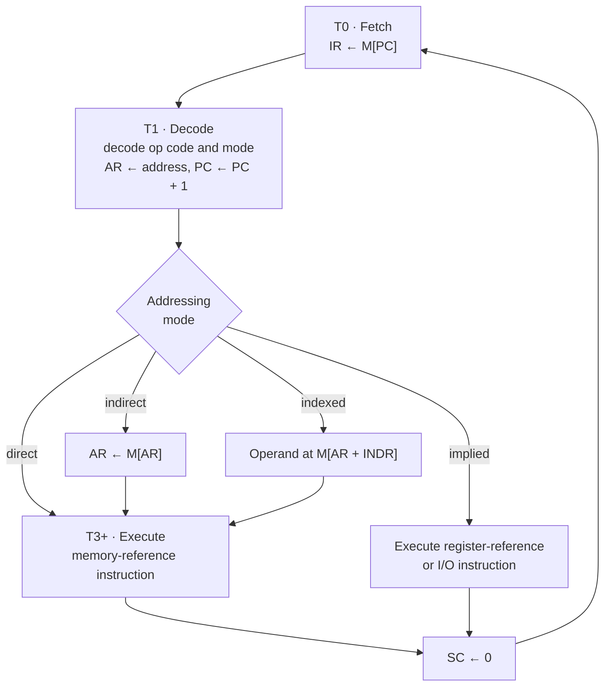

<h1 align="center">Simplex Computer</h1>

<p align="center">
  <b>Design of a 16-bit basic computer: instruction set, registers, bus, hardwired control and microoperations</b><br>
  CS222 Computer Organization &amp; Assembly Language · GIK Institute of Engineering Sciences &amp; Technology · 2021
</p>

<p align="center">
  <a href="docs/Design-Report.pdf"><b>📄 Design report (28 pp.)</b></a>
</p>

---

> [!NOTE]
> This is a coursework project from my undergraduate studies (BS Computer Science, GIKI). I'm posting it to GitHub retroactively, for the record.

## Overview

The Simplex Computer is a paper design for a small 16-bit, accumulator-based computer with a von Neumann architecture, in the tradition of Morris Mano's Basic Computer. Beyond the minimum a basic computer needs (arithmetic, logic, shifts, I/O and program control), it adds indexed addressing, exchange and decrement-and-skip instructions, and interrupt-driven I/O. The report specifies the design down to the register-transfer level: every instruction is broken into the microoperations it performs on each clock pulse.

## Instruction format

Every instruction is one 16-bit word:

| Bits | 15–14 | 13 | 12–9 | 8–0 |
| --- | :---: | :---: | :---: | :---: |
| **Field** | Addressing mode | GPR bit | Op code | Address |

The 9-bit address field reaches all **512 words** of the 16-bit memory.

| Mode | Code | Effective address |
| --- | :---: | --- |
| Direct | `00` | The address field itself |
| Indirect | `01` | The word stored at the address field |
| Indexed | `10` | Address field + index register (INDR) |
| Implied | `11` | No memory operand: register-reference and I/O instructions |

## Registers

| Register | Bits | Purpose |
| --- | :---: | --- |
| AC: Accumulator | 16 | Holds intermediate arithmetic and logic results |
| DR: Data Register | 16 | Holds an operand read from memory |
| IR: Instruction Register | 16 | Holds the instruction being executed |
| AR: Address Register | 9 | Holds the memory address; the only register wired directly to memory |
| PC: Program Counter | 9 | Address of the next instruction |
| INDR: Index Register | 9 | Offset added to the address in indexed mode |
| IOB: I/O Buffer | 9 | Holds the character being input or output |

Flip-flops: **E** (carry), **S** (start/stop), **R** (interrupt pending), **IEN** (interrupt enable), **FGI** and **FGO** (input and output flags).

Registers and memory share one **16-bit common bus** driven through multiplexers. Each register has load, increment and clear control inputs, and three select lines choose which one drives the bus.

## Instruction set

32 instructions in three groups:

| Group | Instructions |
| --- | --- |
| **Memory reference** (direct / indirect) | `ADD` `SUB` `LDB` load AC · `STB` store AC · `AND` `OR` `CMP` · `JMP` jump · `JSR` jump and save return address · `EXG` exchange AC with memory · `DSZ` decrement and skip if zero |
| **Memory reference** (indexed) | `LDIN` `ADDIN` `SUBIN` `ANDIN` `ORIN` |
| **Register reference** | Clear AC · clear E · complement AC · complement E · circulate AC right / left · increment AC · skip if AC positive · skip if AC zero · halt |
| **Input / output** | `INP` `OUT` · `SKI` `SKO` skip on input / output flag · `ION` `IOF` interrupts on / off |

## Control unit and instruction cycle

Control is **hardwired**: a 2×4 decoder turns the addressing mode into signals A0–A3, and a 4×16 decoder turns the op code into D0–D15. A 4-bit sequence counter feeds a second 4×16 decoder to produce the timing signals T0–T15.



Each instruction is then a short sequence of microoperations, one per clock pulse. For example, `ADD` takes two pulses after decode:

```
T3: DR ← M[AR]
T4: AC ← AC + DR,  E ← carry out,  SC ← 0
```

**Interrupts.** I/O is interrupt-driven. When interrupts are enabled and an input or output flag is set, R is set to 1. At the end of the current instruction the computer runs an interrupt cycle instead of fetching. The cycle saves the return address in memory word 0, branches to word 1 and disables further interrupts:

```
RT0: AR ← 0,  TDR ← PC
RT1: M[AR] ← TDR,  PC ← 0
RT2: PC ← PC + 1,  IEN ← 0,  R ← 0,  SC ← 0
```

The report also covers the I/O configuration, the control logic for the address register and accumulator, and the full microoperation table for every instruction.

## Team

**Asad Shahab** · Shams Ghani · Mahad Iqbal · Ahmed Bin Faisal

Instructor: Dr. Ghulam Abbas

## References

1. M. Morris Mano. *Computer System Architecture*, 3rd edition. Prentice Hall.
2. W. Stallings. *Computer Organization and Architecture: Designing for Performance.*
